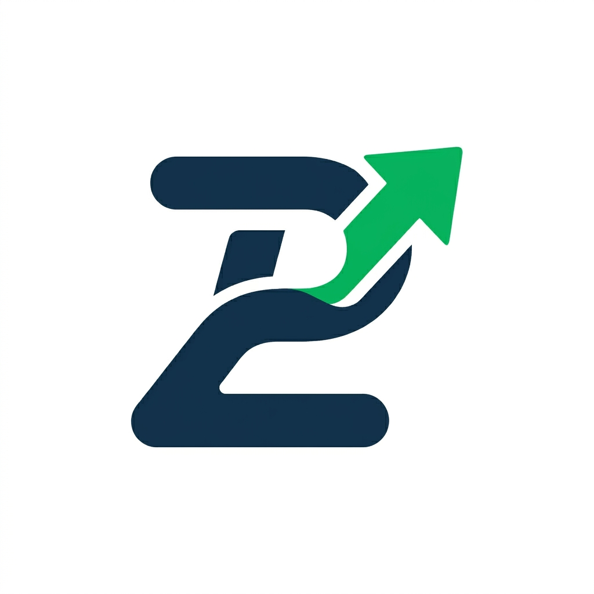

# Stock Dashboard


一个面向美股和 A 股场景的实时股票看板项目，采用前后端分离的 Monorepo 结构：`FastAPI + React + TypeScript + Redis`。

项目重点放在三个方向：

- 实时行情与自选股体验
- 热点市场与财经资讯浏览
- 轻量 AI 洞察与页面级分析

适合用来做金融类数据看板原型、全栈练手项目、可视化作品集，或者继续扩展成更完整的股票终端。

## Preview

<p align="center">
  
</p>

## Why This Project

- 支持 `US` 和 `CN` 双市场切换，搜索、行情、热点页统一处理
- 支持自选股管理与 WebSocket 实时订阅更新
- 支持不同周期的 K 线 / 分时图查看
- 支持热点页、涨跌榜、活跃榜、市场宽度和板块热力图
- 支持财经新闻聚合与 AI 新闻摘要
- 支持对 Dashboard / Hotspot 页面上下文做 AI 分析
- 支持中英文切换、本地缓存和基础偏好设置
- 已提供 Docker Compose 与 Render 部署配置

## Core Features

### 1. Watchlist 与实时行情

- 按股票代码或名称搜索标的
- 将股票加入自选列表并持久化在本地
- 通过 WebSocket 订阅自选股的实时价格、涨跌幅与成交量
- 支持断线重连和订阅自动同步

### 2. 图表与日内快照

- 支持 `1D / 1W / 1M / 3M / 1Y` 多周期切换
- 日内支持 `5m / 15m` 细粒度查看
- 展示开盘、昨收、最高、最低、振幅、换手率、成交额等快照信息
- 提供相关标的推荐，便于继续跳转浏览

### 3. 市场热点页

- 展示核心指数、涨幅榜、跌幅榜、活跃榜
- 提供市场宽度统计与板块热力图
- 支持美股 / A 股热点切换
- 页面支持 AI 进行整体行情解读和风险提示

### 4. 财经资讯与 AI 洞察

- 聚合财经新闻流
- 提取关键词并支持 AI 摘要
- 支持基于当前页面上下文生成总结、情绪判断、关键信号和风险提示
- AI Provider 可在前端配置并保存在浏览器本地

### 5. 体验细节

- 中英文界面切换
- 本地缓存热点、资讯与部分详情数据
- 自定义涨跌配色方案
- AI 接口配置面板内置 `DeepSeek / Qwen / Custom`

## Tech Stack

### Frontend

- React 19
- TypeScript
- Vite
- Zustand
- 原生 SVG 价格与成交量图表
- CSS

### Backend

- FastAPI
- Pydantic
- Uvicorn
- Redis
- WebSocket
- 腾讯财经批量报价 / 中美股日线
- 新浪分时 / 新浪与东方财富新闻
- Yahoo Finance 美股图表与榜单回退
- AkShare（A 股代码目录）

### Deployment

- Docker Compose
- Render Blueprint

## Project Structure

```text
.
├─ backend/
│  ├─ app/
│  │  ├─ api/
│  │  │  ├─ routes.py
│  │  │  └─ ws/
│  │  ├─ core/
│  │  ├─ models/
│  │  ├─ schemas/
│  │  ├─ services/
│  │  └─ main.py
│  ├─ requirements.txt
│  └─ Dockerfile
├─ frontend/
│  ├─ public/
│  ├─ src/
│  │  ├─ lib/
│  │  ├─ services/
│  │  ├─ store/
│  │  ├─ App.tsx
│  │  ├─ App.css
│  │  ├─ index.css
│  │  └─ main.tsx
│  ├─ package.json
│  └─ Dockerfile
├─ docker-compose.yml
├─ render.yaml
├─ .env.example
└─ README.md
```

## 本轮数据源改造（2026-11-01）

Windows 已安装依赖时，双击根目录 `启动看板.cmd`；也可以执行 `powershell -File scripts/start.ps1`。入口为 http://127.0.0.1:5173，日志位于 `.local/`。

- 自选股由一个 WebSocket 后台任务合并订阅；中美股共用腾讯免费批量报价，HTTP 与 WebSocket 共用短缓存。
- 按工作日交易时段估算调度，交易时段目标每 2 秒检查，休市每 30 秒检查；节假日和交易所临时停市以源站时间为准。
- **刷新间隔不是交易所行情延迟。** 本轮腾讯美股数据包含 `delay` 标志，页面显示延时报价；尚未验证盘中端到端延迟。
- 历史数据源失败时返回明确错误，或显示带过期标记的真实缓存；已删除随机 K 线和默认示例报价。
- 市场概览先返回缓存或样本数据，后台刷新完整 A 股快照。A 股完整快照目标 30 秒更新；美股概览目标 15 秒更新。样本宽度不标成全市场宽度。
- 中美股日线支持腾讯；美股日内图使用 Yahoo 双域名回退；A 股分时使用新浪。新闻并行读取新浪和东方财富。
- 原始实测见 `reports/`，检查结论与限制见 [检查报告](reports/2026-11-01-audit.md)。报价缓存和订阅合并范围为单个后端进程。

可复查命令：

```powershell
backend/.venv/Scripts/python.exe scripts/check_sources.py --api http://127.0.0.1:8000 --output reports/source-recheck.json
cd backend
.venv/Scripts/python.exe -m unittest discover -s tests -v
```

## 行情加载与 K 线切换（2026-11-02）

最新自检修复了刷新丢失图表选择、表单快捷键误触和旧 AI 分析重新出现；后台标签页及未打开的页面暂停无用轮询，历史图避免随报价重复计算。[自检记录](reports/2026-11-02-self-audit.md)。

后续补充断网恢复立即刷新与推送重连、取消请求的缓存竞态修复，以及主图 / 副图点按和横拖读数、纵向页面滚动、图表键盘导航。[弱网与触控验证](reports/2026-11-02-resilience.md)。

行情按股票和周期缓存；切回已看过的周期、同标签页刷新时先显示缓存并后台更新。后端过期缓存也立即返回并启动一次后台刷新，慢主源会提前启动备用源；分时备用请求仅获取所选天数，北交所日 K 优先使用东方财富。页面资源与行情 JSON 启用压缩。

K 线可以选择日 K，以及 1 / 5 / 15 / 30 / 60 分钟 K；另选显示范围。日 K 支持 1 月 / 3 月 / 1 年，分钟 K 支持当天 / 五日（1 分钟暂限当天）。周期、图表类型和显示范围独立管理，折线往返保留选择；只有一根真实 K 线也可以绘制。[分钟 K 功能验证](reports/2026-11-02-candle-intervals.md)。

[修改与实测记录](reports/2026-11-02-loading.md)。

## 网站体验改造（2026-11-01 第二轮）

已加入手机 / 平板布局、K 线和 MA20、市场时区、完整实时快照、美股在线搜索、A 股 ETF 搜索、新闻筛选和站内摘要阅读。搜索支持上下键与回车，自选股继续保存在当前浏览器。

[本轮修改、验证和剩余短板](reports/2026-11-01-ux.md)。后续已补齐 AI 设置、接口切换、新闻分析与行情图标注，见下节。

## AI 分析与图上标注

右上角「设置」添加接口并测试连接，支持多套配置切换。资讯页分析最新新闻，看盘页按所选股票和周期分析报价、OHLCV、均线 / RSI / MACD、新闻与指数，并直接标注支撑、阻力、放量等关键点。点击标注查看依据。

密钥默认只保存在当前会话；需要持久保存时勾选「在此设备记住密钥」。支持 Chat Completions 和 Anthropic Messages；接口地址及模型可自行填写。分析仅在点击按钮时执行。

[功能与验证记录](reports/2026-11-01-ai.md)。真实模型调用需在设置中填写用户自己的接口和密钥；本轮完成受控接口联调，未宣称真实模型分析准确率。

## 可选图表指标

在行情图「指标」中勾选 MA5 / 10 / 20 / 60、EMA12 / 26、布林带，以及成交量、MACD、RSI、KDJ、ATR、OBV、CCI、ROC。支持主图叠加、多副图、联动读数和浏览器保存；日线自动补取计算用历史。

[指标计算与验证](reports/2026-11-01-indicators.md)。

设置中可即时切换深色 / 浅色主题，以及绿涨红跌 / 红涨绿跌配色。K 线、成交量、MACD 柱、行情数字和市场涨跌分布同步切换，偏好自动保存在当前浏览器。[外观验证记录](reports/2026-11-01-appearance.md)。

支持中文 / English 即时切换并自动保存。导航、行情、指标、表单和状态提示随语言切换，日期与数字使用相应格式；AI 分析请求按所选语言生成结论和图表标注，切换语言会清除旧分析。新闻原文、股票名称与自定义接口名称保留原内容。[双语验证记录](reports/2026-11-01-language.md)。

行情图下方显示今开、昨收、最高、最低、振幅、量比、成交量、成交额、换手率、市盈率、市净率和总市值。数值随报价快照更新；源未提供的项目显示 `--`。[字段接入与实测](reports/2026-11-01-quote-metrics.md)。

默认打开一分钟「分时」；「五日」展示最近五个交易日，每天独立连线并留出隔夜间隔。中美分时均优先使用腾讯，与报价主源一致；A 股提供成交均价线。分时与前复权日 K 分开，点击 K 线切换至日线月份视图。月 / 季 / 年按日历窗口选取，不再用固定交易点数代替。分时按价格观察值计算可用指标，ATR / KDJ / CCI 在日 K 中使用。[密度、数据源与断线修正](reports/2026-11-01-intraday.md)。

## Quick Start

### Requirements

- Python `3.11+`
- Node.js `22.12+`（本轮验证使用 Node 24）
- npm
- Docker / Docker Compose（可选）

### Option 1: Run With Docker Compose

1. 复制环境变量模板：

```bash
cp .env.example .env
```

2. 启动全部服务：

```bash
docker compose up --build
```

3. 打开服务：

- Frontend: `http://localhost:5173`
- Backend API: `http://localhost:8000`
- API Docs: `http://localhost:8000/docs`

### Option 2: Run Locally

#### Backend

```bash
cd backend
python -m venv .venv
.venv\Scripts\activate
pip install -r requirements.txt
uvicorn app.main:app --reload --host 0.0.0.0 --port 8000
```

#### Frontend

本地开发无需创建环境变量文件。若需连接独立部署的后端，可以在 `frontend` 下新建 `.env.local`：

```env
VITE_API_URL=http://localhost:8000
VITE_WS_URL=ws://localhost:8000
```

然后启动前端：

```bash
cd frontend
npm install
npm run dev
```

默认前端开发服务运行在 `http://localhost:5173`。

## Environment Variables

根目录 `.env.example` 当前包含：

```env
POLYGON_API_KEY=your_polygon_api_key_here
QUOTE_REFRESH_SECONDS=2
```

常用变量说明：

| Variable | Required | Description |
| --- | --- | --- |
| `POLYGON_API_KEY` | No | 增强美股热点页与市场快照能力，未配置时会使用回退逻辑。 |
| `QUOTE_REFRESH_SECONDS` | No | 交易时段报价检查间隔，默认 2 秒，范围 1–30 秒；休市 30 秒。 |
| `VITE_API_URL` | No | 前端访问后端 API 的基础地址。 |
| `VITE_WS_URL` | No | 前端连接 WebSocket 的基础地址。 |

说明：

- `VITE_API_URL` 不需要手动追加 `/api/v1`，前端会自动补齐
- `VITE_WS_URL` 需要写成 `ws://` 或 `wss://`
- 不设置时默认同源访问；Vite 将 `/api`、`/ws`、`/health` 转发至 `127.0.0.1:8000`。Docker 使用 Nginx 同源转发。Render 分离部署仍需设置后端地址。

## API Overview

### REST Endpoints

- `GET /health`：进程健康检查（不代表上游数据正常）
- `GET /api/v1/market/quotes?tickers=AAPL,NVDA,600519`：共享批量报价，返回可用报价和不可用代码
- `GET /api/v1/stocks/search?query=AAPL&market=US`：搜索股票
- `GET /api/v1/stocks/{ticker}/quote`：获取最新报价
- `GET /api/v1/stocks/{ticker}/history?period=1mo&interval=1d`：获取历史行情
- `GET /api/v1/stocks/{ticker}/recommendations`：获取相关股票推荐
- `GET /api/v1/market/hotspots?market=US`：获取市场热点
- `GET /api/v1/news?market=ALL&limit=200`：获取财经新闻
- `POST /api/v1/ai/providers/test`：测试配置的模型接口
- `POST /api/v1/ai/analyze`：获取当前新闻 / 行情上下文，分析并返回结构化图表标注
- `POST /api/v1/news/ai-insights`：旧版新闻 AI 接口
- `POST /api/v1/ai/context-insights`：生成页面上下文 AI 分析

### WebSocket

- `WS /ws/stock-updates`

客户端订阅消息示例：

```json
{
  "type": "subscribe",
  "data": {
    "ticker": "AAPL"
  }
}
```

服务端推送示例：

```json
{
  "type": "update",
  "data": {
    "ticker": "AAPL",
    "price": 189.32,
    "volume": 18423423,
    "change_percent": 1.27
  }
}
```

## Deployment

### Deploy on Render

仓库已经包含根目录 [render.yaml](/e:/Stock%20Dashboard/render.yaml)，可以直接通过 Render Blueprint 部署。

推荐拆成两个服务：

- `stock-dashboard-api`：Render Web Service，运行 FastAPI 后端
- `stock-dashboard-web`：Render Static Site，部署前端 Vite 构建产物

部署步骤：

1. 将仓库推送到 GitHub
2. 登录 Render，选择 `New +` -> `Blueprint`
3. 绑定仓库，Render 会自动识别 `render.yaml`
4. 在前端服务中配置：

```env
VITE_API_URL=https://your-backend.onrender.com
VITE_WS_URL=wss://your-backend.onrender.com
```

5. 如需增强美股市场数据能力，再给后端服务补上：

```env
POLYGON_API_KEY=your_polygon_api_key_here
QUOTE_REFRESH_SECONDS=2
```

### Render Notes

- 免费套餐可能存在冷启动等待
- 前端是静态站点，后端需要独立部署
- `VITE_API_URL` 不需要手动追加 `/api/v1`
- `VITE_WS_URL` 请使用 `wss://`

## Suitable Use Cases

- 作为股票终端或金融可视化产品的原型项目
- 练习 `FastAPI + React + WebSocket` 的全栈协作
- 扩展成多市场、多模块的实时数据看板
- 接入自定义 AI Provider，做轻量金融分析辅助

## Development Notes

- 后端 API 标题为 `FinSense Board API`
- 前端使用 Vite 和 TypeScript 严格模式
- 仓库内包含 Redis 与容器化配置，便于本地联调
- 当前 README 主要聚焦项目启动、部署与能力概览，后续可以继续补充页面截图和演示 GIF

## Roadmap

- 增加更多行情源与更稳健的降级策略
- 增加用户体系和云端 watchlist 持久化
- 增加更多指标、筛选器和联动分析模块
- 补充界面截图、架构图与 Demo 视频
- 增加测试、CI/CD 和质量检查流程

## Acknowledgements

- [FastAPI](https://fastapi.tiangolo.com/)
- [React](https://react.dev/)
- [Vite](https://vitejs.dev/)
- [ApexCharts](https://apexcharts.com/)
- [yfinance](https://github.com/ranaroussi/yfinance)
- [AkShare](https://github.com/akfamily/akshare)

## Support This Project

如果这个项目对你有帮助，或者你觉得它对你的实盘看板、作品集、学习路线有启发，欢迎给仓库点一个 `Star`。

你的支持会让我更有动力继续完善这个项目，包括：

- 更完整的市场数据能力
- 更顺手的交互体验
- 更稳定的部署与工程化能力

如果你愿意，也欢迎提出 Issue 或一起交流改进方向。感谢关注。
